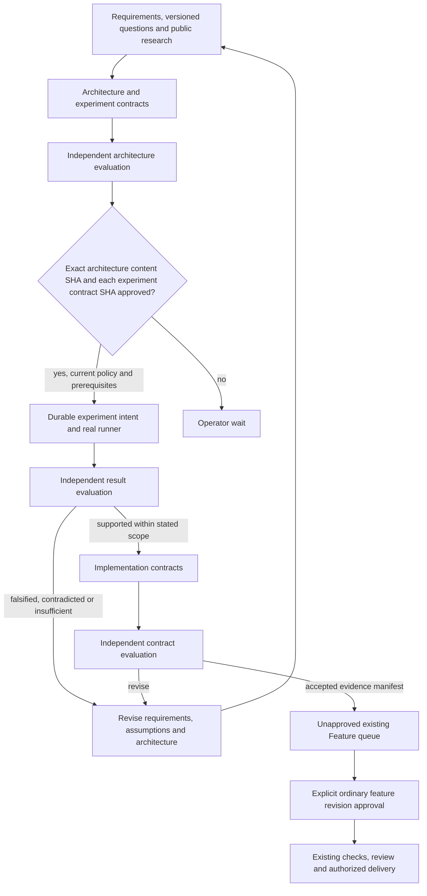
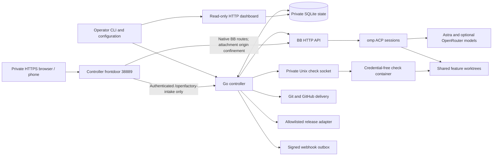
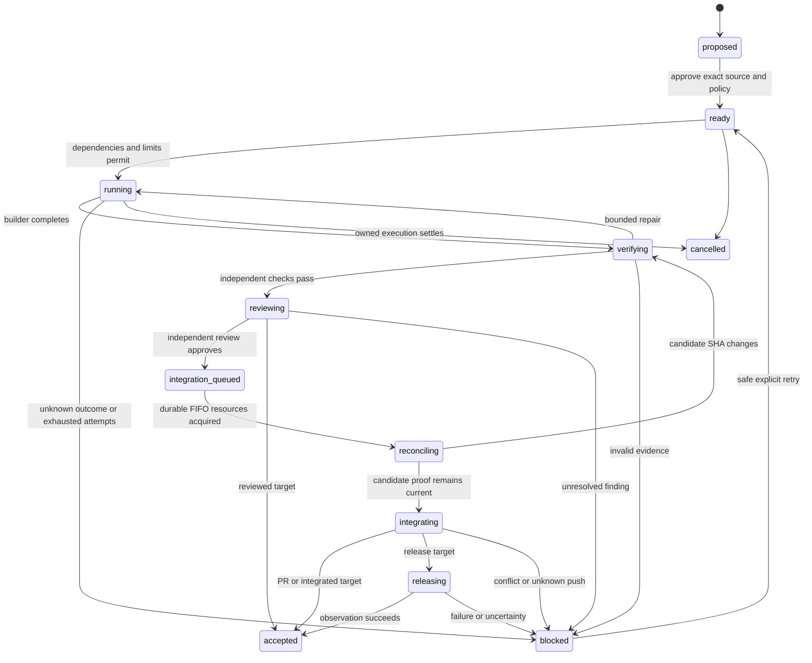

# OpenFactory architecture

A general-purpose, MIT-licensed factory for trusted repositories. The operator
approves versioned feature contracts; a small **Go + SQLite** controller advances
them through **BB → omp → model**, independent checks, review, and an explicitly
permitted delivery target. No continuously reasoning supervisor and no idle model
calls. Model defaults are configured, not inferred from a subscription.

## Source identity and namespace boundary

The Go module and CLI are `openfactory`; the command source is `cmd/openfactory`.
Default policy and database names are `config/openfactory.yaml` and
`openfactory.db`; the public template is `examples/openfactory.yaml`.
Project-owned environment variables use `OPENFACTORY_*`, while upstream names
remain unchanged. The Compose default project and controller service/DNS are
`openfactory`; image names are `openfactory-controller:local` and
`openfactory-bb:local`, with state volume key `openfactory-state` and private
check socket directory `/run/openfactory-checks`.

These are clean source defaults, not compatibility aliases or a state migration.
An existing `.env`, especially `COMPOSE_PROJECT_NAME`, can override the fresh
namespace. Before launch, the operator must explicitly review a fresh environment,
Compose project name and configuration instead of implicitly adopting existing
state or BB homes. Existing installations, private configuration, credentials,
workspaces, containers and volumes remain untouched. The rename performs no
deployment, authentication/data migration, provider change, push, repository
creation or publication.

## Selected boundaries

- Go owns queue state, dependencies, attempts, retry limits, evidence, policy,
  integration, and notification delivery. SQLite is the durable authority.
- BB owns agent sessions and its operator UI. The native OpenFactory plugin registers
  a sidebar panel through the pinned `@get-bb/plugin-sdk@0.6.79`; its server-side
  RPC bridge reads the controller's `/api/status` without mutation authority.
  The controller uses public HTTP contracts inspected from `bb-app@0.47.1`,
  not guessed routes. BB never mounts the controller's SQLite volume.
  The separate native **OpenFactory Intake** panel uses direct authenticated HTTP,
  never mutation RPC or the native worker-chat composer. Its controller frontdoor
  is part of the same Go process, not another application or scheduler.
- omp `18.10.3` runs through BB's native `acp-omp` provider. Astra performs planning,
  building, and independent review; an optional approved OpenRouter model scouts.
- Docker Compose starts the complete stack using `start.sh`. No systemd is needed.
- The first execution model is **explicitly enrolled trusted repositories**, not
  arbitrary internet PRs. Worktrees and model tool policies are not sandboxes.
- Allowlisted production releases are supported, but installation enrolls no
  repository, grants no production authority, and creates no approved work.
- A controller-owned read-only dashboard, CLI, BB threads, and signed generic
  webhooks expose progress. No Muse/WhatsApp integration, distributed scheduler,
  or plugin marketplace.
- OpenFactory must not auto-upgrade its own policy/executable through its own
  release lane. Protected-source changes require an operator decision.

## Discovery Programs

A Program is a first-class versioned research objective, not a delivered feature. Its immutable revisions, manifests, questions, captures, grants, experiment intents/receipts, evaluations and proposals live in the existing SQLite/CAS authority. The existing scheduler admits discovery steps into the same project/global lanes and daily-call reservations as ordinary Features: there is no second scheduler. Lifetime Program call, iteration, step, experiment, search, source and captured-byte budgets survive answers/reimports. `max_calls_per_day` and Program `max_model_calls` count controller-reserved sessions/dispatches, not each provider API turn inside omp's tool loop. Session/time/step bounds provide no hard token, credit, dollar or provider-request ceiling; operators must monitor provider usage/billing and apply provider-side limits separately.

Questions are durable version-bound waits, not repeated polling model calls. An answer creates a new revision requiring exact approval; a stale answer cannot silently change current requirements. Independent evaluation is a separate role/session with controller-stamped input identity, not the author's self-rating. Proposals are not delivery, and publication never grants ordinary implementation approval.

### Public research and model inputs

Research uses explicitly disclosed public topics/URLs: online blogs and GitHub are available through the fixed keyless Parallel MCP broker, not an automatic provider fallback. No credentials, provider homes or secrets belong in search queries. Public input is untrusted data, never execution authority. Captures retain actual response-body and extracted-text hashes, quote occurrence provenance, and GitHub commit provenance where applicable. A quote occurring in a captured page establishes occurrence, not truth. Claims distinguish inference, unknowns and contradictions. Black-box experiments establish bounded observations, not private vendor internals or GPU parity.

Discovery starts in an empty workspace, without a product clone. Only six custom discovery tools are exposed; no bash, eval, task or native web tools. Full immutable context, source and CAS blobs are materialized under `inputs/` for bounded paging rather than silently truncating at 24 KB. Role-specific write restrictions keep evaluators from authoring or retracting another role's artifacts. Uploading a private bundle or importing a proposed Program is a shape-validated, zero-model operation: it copies only explicitly declared regular files and grants no disclosure or execution authority. `private_material_to_models: false` may remain in that saved draft, but strict research/execution approval rejects missing required private-material, provider, or public-search consent; it never silently enables consent. A private browser `file://` path is never a public research source.

The supplied research seeds are primary references: Michael Nygard's [architecture decision records](https://cognitect.com/blog/2011/11/15/documenting-architecture-decisions), [Principles of Chaos Engineering](https://principlesofchaos.org/), and the [OWASP SSRF Prevention Cheat Sheet](https://cheatsheetseries.owasp.org/cheatsheets/Server_Side_Request_Forgery_Prevention_Cheat_Sheet.html). Their captures informed the discovery smoke; they are evidence inputs, not endorsements of generated conclusions.

### Experiment execution and authority

Experiments execute only enrolled argv profiles plus bounded allowed arguments, never arbitrary model shell commands. Exact `ExecutionPolicySHA` binds profiles and limits at controller/runner launch; a stale checker policy fails closed. Policy changes require pause, drain/reconcile, stop, backup and recreation of **checks and openfactory**: an atomic policy edit can leave a read-only single-file bind mount attached to the old inode.

The private Unix runner is a separate trusted same-UID service, **not a hostile-code sandbox**. Checks receives CAS, its own durable journal and the read-only policy file; it receives no SQLite, Git credentials or provider home. The research broker's port 38888 is not host-published. Runner intents, status, receipts and cancellation tombstones are durable and idempotent; an uncertain launch cannot be blindly replayed. Never-started tombstones settle execution identity without inventing observations.

Frozen `BundleFiles` cannot also be observation outputs. Conclusions require complete typed observations and predicates; nonzero exit alone is never falsification. Complete failing predicates can establish falsification without a nonzero exit. Missing prerequisites, timeouts, infrastructure faults or truncated output cannot be replaced by fake observations or a success-shaped fallback. Receipts distinguish execution, observation and hypothesis outcomes. Executable binary SHA is observed; OCI/image identity is operator-declared. Container limits constrain the service, not independently measured per-run resource consumption.

Authority binds exact revision, content, policy and evidence manifests, with expiration/invalidation checked at advancement and admission. A separate `ProgramEvidenceGate` protects generated Features; code `DependsOn` still requires ordinary integrated code receipts and rejects discovery-step dependencies. Invalidation blocks remaining authority and emits impact findings for already accepted product work; it does not revoke historical reality or erase delivered receipts. No auto-provider fallback, account provisioning or credential enrollment is implied.

The dashboard and BB Programs sidebar are read-only. Program list/detail APIs expose bounded pagination, revision/history, questions, architecture, experiments, evidence, linked Features and events. Current-stage output markers identify producer provenance, not grants; historical evidence remains inspectable. See README for exact CLI operations and verification boundaries.

The shared BB bridge uses `node:http`/`node:https` for read-only GETs: the observed BB Node 24 `fetch` runtime ignored explicit Host overrides. Transport retains the configured network URL, DNS destination, TLS SNI and certificate hostname while sending the dashboard's explicit loopback Host authority with its configured port. It follows no redirects and supplies no proxies, cookies or authentication; streaming response and abort bounds remain enforced. This transport choice does not weaken the Go dashboard's Host checks. Actual BB Programs browser verification is recorded separately below.

## Deployment and trust boundaries

The frontdoor node is an opt-in handler in the `openfactory` service's existing Go
process. Private HTTPS forwards **all paths intact** to this one listener, not a
split proxy directly to BB. The same process prebinds and supervises listeners
before admission and drains them before SQLite closes.

Three Compose services share only the resources they require:

| Service | Persistent access | Credential scope |
| --- | --- | --- |
| `openfactory` | `/state`, operator `/config`, `/workspaces`, check socket | Enrolled Git credentials and optional webhook/release credentials |
| `bb` | Dedicated BB/omp home and `/workspaces` | Coding-model credentials only |
| `checks` | `/workspaces`, private check socket, CAS artifacts, durable experiment journal, read-only execution policy | No SQLite, Git credentials, model auth, or production secrets |

No host Docker socket, SSH-agent forwarding, or wholesale host-home mounts. BB's
command-capable UI/API is published on host loopback only. Containers are nonroot,
read-only except explicit volumes/tmpfs, with resource and process limits. The
check service executes approved commands in a workspace under the allowed root,
with a fresh temporary HOME and bounded process group/output/lifetime. It has no
controller-secret mounts. Repository checks in local non-Docker mode are trusted
local execution unless an isolated check socket is configured.

Release commands run with controller authority and therefore must be deliberately
enrolled operator executables under read-only `release_dir`, never candidate-owned
scripts. Their cwd is a controller-private clean export of the exact candidate.
Clearing environment variables is not filesystem isolation.

BB's API network contains only the controller and BB. Checks have an isolated
internal network by default, not a route to the unauthenticated BB API. An explicit
check-network overlay allows dependency downloads on a separate egress bridge;
it restores outbound/host-service access and is only for trusted checks.

## Work intake

`enqueue` imports Markdown with YAML front matter. Each feature has a stable ID,
project, goal, dependencies, completion target, named check profiles, and observable
acceptance scenarios. The source revision is hashed; approvals bind the exact
revision plus current operator-policy hash. Editing a source file cannot alter an
already approved contract. Invalid fields, unsafe identities, missing dependencies,
and cycles are rejected. Re-imports of identical contracts are idempotent.

`plan PROJECT GOAL.md` authorizes only a bounded read-only planning task. Astra
inspects the current source and proposes dependency-ordered feature contracts.
Those proposals are not self-approved. Existing capabilities and evidence should
be reused rather than rebuilt because an old roadmap lists them as missing.

Examples cover a CLI behavioral feature and a broader importer goal. Inference
platforms are consumers of this same contract, not special logic in the core.

## Phone-dictated OpenFactory Intake

### Native interaction, durable Save, and explicit model disclosure

The native BB sidebar panel is `/plugins/openfactory/intake/*`. Phone keyboard
dictation supplies **text**, not an audio-upload or transcription service. This
is a controller-owned conversation, not a hijack of BB's native worker composer:
the plugin cannot submit uncontrolled model work through a chat hook or mutation
RPC. Recorded worker thread IDs link to BB's actual engineering sessions.

`request.create` and `turn.append` **save only**. They persist exact text and
client message identity with zero model dispatches and no disclosure grant.
Reloading a saved request, inspecting progress, and waiting for questions are
also zero-model operations. A Send flow saves first; **Generate Proposal** is a
separate `intake.draft` command bound to the current saved content version.
`POST /openfactory-intake/v1/disclosures` prepares the exact current context,
configured provider/model selectors, policy and selected bundle hashes for
review before that bounded read-only drafting consent. There is no arbitrary
browser model selector, silent context trimming, or provider fallback.

The request, append-only turns, bound consequential questions, immutable draft
revisions, worker steps, links and monotonic progress events live in SQLite/CAS.
Content writes use expected `ContentVersion`; progress event sequence alone does
not invalidate an unchanged review. A request has one immutable project. A
project switch or amendment of submitted work creates a linked request rather
than rewriting accepted authority.

Draft output is a strict union: one to three consequential questions, a
Feature/plan/Program draft, or an explicit blocked prerequisite result. Missing
decisions and resources remain visible waits; there is no automatic repair
loop, invented hardware evidence, or success-shaped fallback. Answers bind the
request/question/input/output identity before another explicit Generate.

### Existing scheduler and canonical contracts

Intake uses the existing internal Feature → Attempt → reserved call → BB/omp
lifecycle, not a second scheduler or a plugin model process. The controller
creates server-only intake associations; external imports cannot manufacture
them or depend on internal intake/discovery work. Product boards hide these
internal rows while shared capacity includes them truthfully.

Every draft dispatch consumes the same project/global lane and global daily
reservation as ordinary engineering. The packaged daily default remains 30;
the request's default lifetime cap is 12 reserved draft dispatches, frozen when
created, with one active step. Edits, retries, reconnects and restarts do not
reset that allowance. Historically recorded global/project lane
enrollment is operator policy, not a new default or permission to resize a live
stack; a deployment retaining reviewed caps shares those exact lanes. Reservations
are not provider-turn, token, credit or dollar ceilings.

The dedicated pinned omp intake profile starts in an empty, scoped workspace
without a product checkout. Its only model tool is `intake_read`, paging
immutable manifest-bound context/CAS inputs with UTF-8 byte bounds. No native
bash, eval, task, web, read/write, ambient extension, skill or research authority
is available through this profile. The separate six-tool Discovery profile is
unchanged. Unknown external ownership retains capacity until reconciled;
superseded work must stop or settle before replacement releases its ownership.

Internal step creation leaves intake queued. The existing admission gate supplies
its concrete wait; a rejected Claim commits that projection without creating an
attempt or charging a call. A successful Claim atomically binds the attempt,
publishes drafting and clears the queued wait. SetWait, Save, ReserveCall and
ordinary reconciliation mirror the actual owned attempt's wait, including its
clearing. There is no parallel admission algorithm or optimistic running state.

Review preserves **exact source bytes** and their SHA separately from the
normalized canonical payload and domain revision. Existing Feature Markdown/YAML
parsing/export, shared read-only plan construction, and Program JSON/limit
normalization are reused. Ordinary historical Feature hashes remain unchanged
when the new internal intake association is empty.

Routes have different authority:

- **Feature:** exact trusted project, check names, acceptance and allowed target;
  queueing does not add production authority.
- **Plan:** a bounded read-only planning Feature. Questions bind its revision,
  attempt and output SHA; an answer creates a new unapproved planning revision.
  Published children remain unapproved and need ordinary Feature approval.
- **Program:** a versioned research objective with selected seed manifest and
  answer lineage. Approval never grants architecture, any individual frozen
  experiment, or final product implementation. Each gate is distinct; generated
  product Features still require their exact ordinary revision approval.

Private files are explicitly staged into bounded CAS bundles with declared
logical paths, sizes and hashes, not crawled or treated as public `file://`
seeds. Upload/finalization, canonical draft replacement and CLI Program import
are **not model consent**. A manually saved Program may contain private seeds
with consent false and remain exportable. `intake.approve_queue` is atomic
import **plus execution grant**, so missing strict execution disclosure is
rejected before human-proof issuance or domain effects; it does not silently
flip consent, partially import, or skip approval.

### Human identity and exact grants

BB client/plugin identity, the readonly RPC bridge, local-origin claims,
Tailscale headers and service keys are not a human operator. A trusted local CLI
creates an operator with explicit enrolled project scope and issues a one-time
256-bit random pairing secret. Only its SHA-256 is stored; the browser link
carries the secret in a fragment, never query/log/model context, and clears it
before the first API exchange. The default pairing lifetime is ten minutes,
shortenable by policy.

Registration uses maintained `go-webauthn/webauthn v0.18.2` verification, required
user verification, the exact configured RP/origin, and server-stored ceremony
state, not handwritten COSE/signature parsing. Library credential/counter/backup
semantics apply; synced passkeys with a zero counter are not universally rejected.
The pending credential is **not active**. The operator reads its full SHA-256
fingerprint from the **successful phone registration screen** and supplies that
value to trusted CLI `operator confirm`. CLI pairing inspection never echoes a
confirmation value. A mismatch revokes that pairing; a new pairing and
registration are required. Confirmation atomically activates that pending
credential and consumes its pairing; a fresh passkey login is still required.
Authenticator private keys stay in the OS/authenticator, not BB or controller.

Authenticated Save/answer/refine/cancel writes require an HttpOnly, Secure,
SameSite=Strict session cookie `openfactory_intake_session` scoped to
`/openfactory-intake/`, exact browser Origin, JSON and synchronizer CSRF proof
in `X-OpenFactory-CSRF`. Sessions bind live operator,
credential, generation and project scope. No CORS allowance or proxy actor
header substitutes for these checks.

Every execution/authority grant requires a **fresh UP+UV ceremony** bound
server-side to one exact typed command: intake queue, Feature revision, Program
revision, architecture artifact, individual frozen experiment, retry or resume.
Review claims bind installation/actor/credential, request/content/draft versions,
canonical payload, manifest, policy, subject/evidence/bundle hashes, command and
challenge identities and expiry. The commit accepts the stored command/
challenge IDs plus assertion, not replacement authority payload. Current scope,
policy, revisions, evidence, credential state and one-time challenge consumption
are checked in the same transaction as domain mutation, audit and receipt.
Trusted local CLI writes record `trusted_local`, never fabricated WebAuthn proof.

The browser verifies the supplied exact canonical bytes rather than reconstructing
Go JSON from displayed objects. A full execution-policy document is deliberately
not exposed: its global host paths/argv are private; its SHA remains an **opaque
fingerprint**, not independently browser-verified policy material. A passkey
proves the requested ceremony, not that an authenticator displayed the contract
or that a physical phone was used. Trusted frontend integrity remains a boundary.

### Durable commands and restore

`POST /openfactory-intake/v1/commands` accepts a strict action-specific union with
stable client UUID and expected content version, never a network-supplied actor,
approval bit, shell, provider override or policy. Authenticated access is checked
before idempotent receipt lookup. The permanent operator+command tombstone
returns the same committed result for identical content, rejects changed content
under the same ID, and prevents duplicate jobs or regrants. A genuinely new
stale command fails instead of replaying against a new subject.

After a lost response, the client reconciles the original command receipt and
retries only the identical command identity. The journal retains pending IDs,
send/version fences and exact non-sensitive `intake.draft` disclosure metadata,
scoped to origin, operator, installation and auth generation. A mismatch is
unresolved, not permission for automatic replay. Private transcript/source/answer
bodies, passkey material, cookies and CSRF are never localStorage recovery data.
Submitted means handoff committed, not delivered. Revoking a device/operator
blocks future sessions/challenges/commands, but previously approved budgeted
work continues unless explicitly cancelled and externally settled.

`program.resume` can recover one server-selected current, settled failed worker,
not every blocked step. Its canonical review binds safe step/input, Feature
revision/state/attempt count and latest settled-attempt fingerprints. Commit
rederives that selection before consuming authority; active/uncertain ownership,
superseded inputs, cancelled Programs and exhausted lifetime/attempt caps cannot
be cleared by retry. Existing retry/admission machinery creates the next attempt
without resetting counters or rewriting prior results.

For execution recovery, the existing canonical payload is the exact frozen
ExperimentContract preimage; source and manifest canonical identity remain the
ProgramSpec. Existing architecture/contract grants, bundle and opaque execution
policy must still match. Recorded prior launches need terminal, non-conclusive
failure evidence; supported and falsified conclusive receipts are not retry
failures. The distinct `prior_launch_absent` case requires a settled attempt and
no recorded dispatch, thread, environment, call, intent or receipt—never an
inference from a missing receipt after an intent. A new attempt derives a new
canonical run identity. `MaxExperiments` retains its existing logical-step
accounting; physical retries require fresh exact authority and remain bounded
by Feature attempt caps and per-run limits. Model retries still reserve each
dispatch against ordinary daily and Program lifetime call budgets.

`operator restore-auth --confirm invalidate-all-browser-auth` is mandatory
trusted recovery **before exposing restored state or admitting restored work**.
It rotates auth generation, revokes **all existing credentials**, and invalidates
sessions, challenges and pairings. Fresh trusted CLI pairing/registration/
confirmation is required; an old key cannot simply log in again. Operators and
historical work remain; normal restart does not reset auth. Arbitrary SQLite or
whole-volume rollback is not automatically detected by an external epoch file.
Back up SQLite, CAS and configuration together, respect forward-only schema 4,
and reconcile external attempts/experiments before resume.

### One private browser frontdoor

The opt-in listener defaults to `127.0.0.1:38889`. It is prebound and validated
before admission, supervised and drained with other components before SQLite
closes. Non-loopback container binds require an explicit flag; Compose publishes
only host loopback. Disabled `intake.enabled` preserves CLI-only operation and
opens no frontdoor. Public bootstrap exposes enabled/origin/path/RP name, not
credential existence or private configuration.

One private HTTPS origin forwards **all paths intact** to this listener:
`/openfactory-intake/*` is stripped internally into the authenticated `/v1` handler;
bare `/v1/*` is not public; other routes proxy native BB. The standard proxy
supports WebSocket/SSE streaming without buffering. Optional `bb_host_authority`
changes only HTTP Host; URL, connection DNS, TLS SNI/certificate identity and
normal remote HTTPS virtual hosts remain unchanged. The frontdoor strips the
operator cookie and CSRF header before BB, retains BB-native cookies and actual
Origin, and neither trusts nor regenerates actor/proxy identity headers.

Worker-controlled BB attachment content at
`/api/v1/projects/{oneID}/attachments/content` receives enforcing
`Content-Security-Policy: sandbox allow-scripts` **without allow-same-origin**,
plus `nosniff`, for every content type/status including 304 and gateway errors.
Existing CSP remains enforced. Escaped IDs, queries, normalized paths and a
configured BB base path cannot bypass that boundary. Scripts may run only with
an opaque origin, not the operator approval origin; other BB responses are not
blanket-rewritten. BB receives no controller database/auth/secret mount or bridge
key. Do not expose a direct BB/path proxy around this confinement.

The complete operator recipe is
[`examples/intake-private-https.txt`](examples/intake-private-https.txt). Its
single Tailscale Serve root target is `http://127.0.0.1:38889`, **not** root to BB
plus a separate prefix mount. No Funnel, wildcard CORS, public ingress or
forwarded-header identity is permitted. Exact lowercase origin/RP validation
rejects credentials, paths, trailing slash, explicit default ports and remote
HTTP; HTTP `localhost` is an isolated-development exception, not phone TLS
bypass. These deployment examples do not reconfigure the stopped operator stack.

Effective `intake` policy is normalized before hashing and exported without live
tokens/credentials. YAML integer limits must actually be integer scalars;
fractional values cannot truncate into authority, and enable/non-loopback flags
must be explicit YAML booleans. Negative/over-cap bounds fail closed.

| Policy group | Actual fields and packaged defaults |
| --- | --- |
| Opt-in origin | `enabled: false`; `external_origin`/`rp_id` empty until explicitly configured; `rp_name: OpenFactory Intake`; fixed `public_path: /openfactory-intake` |
| Listener | `bind: 127.0.0.1:38889`, `allow_non_loopback: false`; runtime flags `--command-listen` and `--command-allow-non-loopback` |
| Text/output | `max_turn_bytes: 16384`, `max_turns: 256`, `max_text_bytes: 2097152`, `max_canonical_bytes: 262144`, `max_output_bytes: 262144` |
| Draft/history | `max_draft_calls: 12`, `history_default: 50`, `history_max: 200`; CLI lists expose bounded `--after`/`--limit` and explicit continuation |
| Auth lifetimes | `pairing_ttl_seconds: 600`, `challenge_ttl_seconds: 120`, `session_idle_seconds: 43200`, `session_absolute_seconds: 604800`, `credential_ttl_seconds: 7776000` |
| Credential/auth bounds | `max_credentials: 10`, `auth_rate_limit: 30`; no inline auth secrets |

Protocol text/output/draft maxima may be lowered, not raised. Exact RP ID equals
the external DNS hostname, without port or parent-domain expansion. Optional
top-level `bb_host_authority` / `OPENFACTORY_BB_HOST_AUTHORITY` is policy-hashed and
empty by default; private Docker phone setup explicitly uses `localhost:38886`
alongside the actual public `BB_APP_URL`, not a static IP or global TLS override.
See the example for persistent BB config precedence and coordinated recreation.

Implementation ownership is visible in source, not duplicated inside the plugin:

| Source | Responsibility |
| --- | --- |
| `internal/model/intake*.go`, `internal/intake/{canonical,protocol}.go` | Typed records/commands, strict codecs, canonical bytes/hashes and shared Feature/plan/Program formats |
| `internal/store/intake_{commands,requests,reviews,auth,planning,bundles}.go` | Durable content, scope, ceremony state, CAS ownership, atomic command/domain/evidence/receipt transactions |
| `internal/engine/intake*.go`, `internal/gitrepo/intake.go`, `deploy/intake-*` | Existing scheduler integration, immutable scoped workspace and the one-tool pinned runtime |
| `internal/operatorauth`, `internal/commandapi`, `internal/frontdoor` | Maintained WebAuthn verification, internal authenticated API and single private browser-origin routing/confinement |
| `plugins/openfactory/intake*`, `cmd/openfactory/{operator,intake}.go` | Native mobile UI and trusted local enrollment/recovery/inspection/export; neither is a second authority ledger |

Store mutations and permanent command receipts commit together through private
transaction helpers. Nested public Store calls inside a transaction are not a
second transaction convention: they can deadlock the single-connection ledger.
Scoped reads expose useful project/check/target/model/limit metadata, not Git
credentials, global argv, private host paths or authenticator secrets.

## Durable execution

The diagram shows logical stages; attempt records distinguish submission,
execution, check, review, integration, release, and uncertain outcomes. A receipt
names the achieved target. A reviewed change or open PR does not satisfy a
code dependency requiring integrated code.

The controller claims work transactionally, reserves daily calls before dispatch,
and bounds global/project concurrency, attempt duration, prompt size, and retries.
It persists attempt/thread/cursor identities before moving on. BB Workflows and
Automations do not independently schedule these same jobs.

Global `max_concurrent` bounds every active attempt, including uncertain owners.
Each project's `max_concurrent` defaults to one, accepts 1..32, and bounds its
independent build/check/review lanes. A project alias does not create a separate
delivery resource. Dependencies and priority admission remain transactional.
Daily-call reservations are keyed by the exact persisted generation-qualified
dispatch identity; a restarted poller cannot spend a second call for the same
dispatch. The global default remains two and daily-call default remains thirty.

Reviewed nonlocal deliveries enter a durable FIFO queue. Atomic all-or-none
acquisition claims canonical repository/branch resources and, for staging or
production, repository/environment resources. GitHub HTTPS/SSH/scp spellings and
case normalize together; local path/file URLs resolve symlinks. The configured
GitHub API owner/repository must match the GitHub transport repository. Custom
remote URLs normalize host/default port/path consistently. These are local ledger
resources, not cross-controller or external Git-host locks.

The durable token fences protected operations and remains held across local
reconciliation, current-generation checks/review, PR/push and release/observation/
rollback. Terminal settlement releases only the matching attempt/token. Unknown
external outcomes retain active capacity and ownership; timeout never steals a
lease. A busy delivery lane does not serialize unrelated builds or repositories.
Before starting the engine, versioned recovery backfills canonical ownership for
legacy active delivery/uncertain attempts. Conflicting unresolved legacy owners
block daemon startup without disabling read/resolve CLI commands.

On restart, the controller reconciles existing attempts before new admissions.
A failed HTTP acknowledgement is not proof that a spawn, push, or deploy failed.
Unknown effects remain blocked until their actual outcome is established; retry
must not discard an unresolved active operation.

### BB protocol constraints

The pinned package has no ordinary empty-thread creation primitive and no exposed
spawn/send idempotency key. The controller persists an exact attempt/stage/
generation dispatch key, includes it in the prompt/title, and records returned
thread identity. Recovery matches durable input events, not mutable titles.
Multiple matches or uncertain absence cannot justify an automatic resend.

Polling uses cursor-aware durable events and root-turn identity. A request ACK,
idle thread, nested subagent completion, old assistant output, interrupted turn,
or malformed result is never feature success. BB environment identity can be
absent while provisioning; a durable thread ID still needs reconciliation.

The packaged omp launcher makes unattended approval mode explicit, disables title
model calls, bounds runtime, and exposes a limited built-in tool set. These are
operating constraints, not adversarial isolation. A shell-capable trusted worker
can execute other programs. OpenFactory-dispatched sessions are visible in BB.

## Token efficiency and model policy

- No model calls to poll, choose ready work, copy logs, or wait for human input.
- Do not run every agent role for every task. Optional scouting is bounded; small
  known-contract features can proceed directly to the builder.
- Pass the feature, relevant acceptance and paths, compact prior findings, and
  concrete failure output—not the whole campaign or entire session histories.
- Run deterministic checks before another expensive review. A reviewer receives
  the candidate and evidence in a fresh session; self-approval is insufficient.
- Limit prompt bytes, calls per day, repair attempts, wall time, and concurrency.
  Use dedicated capped OpenRouter credentials and approved model/provider choices.
- Never silently substitute an API-key route for subscription authentication or
  export a conversation to another provider after a quota error.

Exact billed tokens are **not established by the inspected BB/omp API path**.
Context-window occupancy is not billed usage. Keep unavailable accounting visibly
unavailable; configured call/time limits are not a precise monetary guarantee.
OpenRouter credits, API charges, and subscription quotas are different resources.

## Git authentication and repository integration

Each project declares its own repository, branch, trust decision, auth mode,
checks, protected paths, and optional release profiles. Network authentication is
performed by the controller, never by putting credentials into a checkout URL.

- `none`: public HTTPS repositories or explicitly configured local repositories.
- `token`: a dedicated token file for HTTPS GitHub operations.
- `ssh`: a dedicated private-key file plus a verified `known_hosts` file and strict
  host checking. No automatic unknown-host acceptance or host SSH-agent mount.
- GitHub PR operations require an API token even when the Git transport uses SSH.

Attempt checkouts are self-contained and deterministic. Network repositories,
indexes, candidate objects, enrollment and workspace receipts remain private in
controller state. Privileged Git never reads candidate-controlled Git config.
The controller captures source into a single commit based on the approved base,
then exports a fresh clean checkout for checks and independent review. Ignored
artifacts in the builder's directory cannot satisfy candidate acceptance.
Checks use enrolled argv profiles, not shell commands invented by a ticket.
Capture first copies source through a root-confined filesystem handle into private
temporary storage; Git never reopens an agent-swappable source path. Shared writes
use the same volume-root confinement. Checkouts fetch only the candidate's
reachable history, not every rejected object in the private repository.

Fingerprint gates detect persistent source mutation, not a hostile process that
changes and restores bytes during a check. Process-group cancellation likewise
does not contain a deliberately detached process. This remains a trusted-code,
single-operator factory, not adversarial multi-tenant execution.

Protected paths are checked before executing candidate checks and before
integration. Review is read-only by contract and checked against a workspace
fingerprint. Delivery first persists immutable source-base/source-candidate SHAs
and a reconciliation operation/generation. Using Git 2.38+ `merge-tree --write-tree`,
the controller applies that original delta to the fetched current target in a
private repository and exports a fresh workspace. The source base and applicable
dependency receipts must remain ancestors; rewritten history and conflicts block
without remote writes or automatic agent conflict resolution.

A changed SHA invalidates prior candidate proof: checks and independent review
must pass for the new generation, and approved/protected paths plus release
allowlists are checked again. Fresh dispatches still consume the existing daily
call budget. Reconciliation is idempotent by persisted operation/generation and
does not rewrite a running agent's workspace. Failed reconciliation checks/review
block rather than silently replacing the immutable approved delta with a repair.

Final integration requires a direct parent equal to the expected target SHA and
pushes using an explicit `--force-with-lease=refs/heads/<branch>:<expected>`:
despite Git's option name, this is an exact compare-and-swap fast-forward, never
an unconditional force or history overwrite. Known target movement returns to
reconciliation; ambiguous push results retain ownership. PR publication uses a
create-only feature ref and checks head/base without overwriting unexpected refs.

## Acceptance and release authority

Acceptance requires actual configured checks and observed changed behavior, a
matching candidate identity, independent review, and the required authority. A
model's JSON assertion is not an execution receipt. Synthetic/provider-fixture
results do not establish physical GPU, payment, or production acceptance.

An allowlisted release profile explicitly names target, permitted risks/paths,
expiry, qualification, deploy/observe/rollback argv, observation duration, and
minimum samples. The controller binds each release to its feature, policy, exact
integrated SHA, and evidence. No profile means no release. Expired qualification,
protected changes, failed observations, and unknown effects block advancement.

Before integration, a side-effect-free release preflight checks the same path
matcher, profile, command bounds, and remaining observation/rollback budget used
by release execution. Ordinary policy infeasibility cannot first be discovered
after an irreversible push.

Deploy timeout is uncertain, not permission for blind retry. Rollback runs only
when explicitly enrolled; database changes are not automatically reversible.
Failure and rollback evidence remain attached to the attempt. Real production
profiles require independent operator qualification before enrollment.

## Operations

`start.sh` creates missing configuration from safe examples without overwriting
operator files, builds images, and starts Compose. The default project registry is
empty. Existing approved work resumes after restart. BB/omp auth and SQLite live
in named volumes. Stopping the stack preserves those volumes.

The Go binary runs in the foreground. Compose supervises services; only the
controller owns feature retry policy. A singleton process lock prevents two
controllers owning one ledger. SIGTERM stops admission and cancels/drains owned
work. Active remote BB execution is reconciled, not assumed absent because the
controller process exited.

The controller also supervises a standard-library, server-rendered read-only
dashboard. `run --dashboard-listen` defaults to `127.0.0.1:38887`; empty disables
that readonly listener only, not the separate enabled intake frontdoor or private
research broker. Literal IP/port validation rejects non-loopback binds unless
`--dashboard-allow-non-loopback` is explicit. Compose uses that override for the
container bind `0.0.0.0:38887` while publishing only host `127.0.0.1:38887`.
BB remains at host loopback port 38886. The dashboard is not an authenticated
public service; remote operators should use an SSH tunnel.

GET/HEAD pages/API expose bounded snapshots, per-feature attempts/session IDs,
current-generation checks/evidence, truthful waits and delivery queues, not
percentages or ETA. Tokens, prompts, private workspace/cursor/config data are not
exported in the overview. Mutation methods are rejected; Host checks, restrictive
CSP, no-store, nosniff and no CORS permission narrow the browser boundary.
The HTTP listener is prebound before workers start, supervised with the engine,
and canceled/drained before the process lock and SQLite are released.

BB's existing feature board/recorded timeline is a server-side consumer of the
same `/api/status` DTO, not another scheduler or legacy API. `OPENFACTORY_VIEW_URL`
defaults to `http://openfactory:38887/api/status`; the trusted bridge explicitly sends
the intended `127.0.0.1:38887` Host authority. Its whole-snapshot traversal is
bounded by `OPENFACTORY_VIEW_MAX_PAGES` (default 20, valid 1..100, 500 features/page),
8 seconds and 16 MiB. Limit/error conditions fail visibly instead of returning
a misleading partial board. Browsers receive neither credentials nor mutation
authority from this bridge.

The config directory is mounted rather than one file, so atomic editor saves do
not leave a stale policy inode mounted. Policy changes stop the current controller
run; Compose restarts it and reconciles under the new hash. Existing feature
approvals do not silently expand with policy changes.

Policy/concurrency upgrades require pause, drain and external reconciliation of
unknown operations, then stop/backup, install/edit, restart/recover, re-import and
reapprove affected contracts under the new exact hash, and explicitly resume.
Do not edit a live bind-mounted policy while an old binary watches it. Project
cap zero/omitted normalizes to one before hashing, making omitted and explicit
one equivalent in the new version; adding the normalized field may invalidate
pre-upgrade approvals. Runtime listener flags do not alter the policy hash.
Increasing lanes grants neither more global/call capacity nor release authority.

SQLite authority mutations use immediate transactions: they reserve the writer
before reading approval, admission, or delivery ownership, avoiding deferred
read-to-write upgrades racing another CLI/controller write. Each connection
receives WAL, foreign-key enforcement, and a bounded busy timeout. Read-only
dashboard transactions remain deferred consistent snapshots rather than reserving
the writer. There is no blanket replay of failed authority operations or external
effects to mask contention.

SQLite backups use a consistent database snapshot. Restores require operator
review/reconciliation before re-enabling external effects. BB state/auth and retained
artifacts need their own encrypted backups; a database backup is not a complete
backup of all external resources. Do not delete volumes to fix ordinary failures.

## Notifications

Questions are durable blocked states/events; they do not repeatedly consume model
calls. The CLI shows them and BB exposes the engineering thread. Webhook delivery
uses a durable per-destination outbox, capped retries/backoff, and event expiry.

Messages contain only event/feature identifiers, kind, and creation time. Detailed
source, prompts, logs, and credentials stay local. Sign `timestamp + "." + rawBody`
with HMAC-SHA256. Recipients verify a bounded timestamp window and deduplicate
by event ID. Redirects are refused. Delivery is at-least-once; API acceptance or a
message response never authorizes a release.

## Verification and contribution boundaries

Unit/integration tests must exercise behavior and failure transitions, not copied
constants or source-text wiring. Local bare Git repositories and HTTP fixtures
cover deterministic boundaries without private infrastructure. They are synthetic
and do not replace a live pinned BB/omp integration run or production qualification.

### OpenFactory rename verification

The renamed module/CLI passed the full native race suite, vet and build; Linux
race checks covered artifacts, Store, frontdoor and Git. The renamed plugin passed
typechecking, 111 tests and its build; both image targets built, and pinned
intake/research adapters passed 16 tests with 464 assertions. Compose and shell
checks passed.

An isolated credential-free run verified the fresh CLI/database/policy, standalone
dashboard and installed native BB plugin `openfactory` / **OpenFactory**. Its 390px
browser board read live controller data; Intake reached the renamed bootstrap and
session endpoints and required passkey sign-in. This rename smoke issued no
feature execution, passkey enrollment or model generation. It does not migrate an
existing installation or replace the distinct historical full-workflow evidence.

### Intake evidence and limits

The observations below predate the source rename. They are retained historical
evidence, not verification of renamed source, a fresh namespace or a deployment.

The shared operator stack remains intentionally **stopped**; this phone workflow
is **not rolled out** to its live configuration. Isolated checks do not authorize
starting, reconfiguring or changing provider authentication for that stack.

On **2026-10-29 UTC**, the final complete native Go race suite, static checks,
controller build, Compose validation and shell syntax checks passed. Linux race
coverage passed for artifacts, Store, frontdoor and Git workspace packages.
The installed BB plugin passed typechecking, 111 tests and its build; both
deployment image targets built. Pinned omp adapter checks passed separately.

The integrated browser proof used a clearly labelled deterministic semantic
adapter, not live model reasoning, with actual native BB UI, controller/SQLite,
CAS, passkey cryptography, public HTTP/GitHub capture, Python checks and Git:

- Save persisted without a model reservation; browser close/reopen and normal
  controller restart recovered the same receipt, session/generation and text.
- A Feature reached checked/reviewed Git delivery. A Plan question created a
  new unapproved revision, then two unapproved children; only the explicitly
  approved child ran.
- A Program question required a newly approved revision. Exact fresh UP+UV
  recovery resumed one settled failed research worker, retaining budgets and
  history. Four actual public captures included commit-resolved GitHub blob
  identity; no source snippet was substituted for captured bytes.
- Architecture and each frozen contract required separate approvals. Actual
  Python receipts recorded one conclusive falsification and two supported
  predicates. Failed contract-evaluation output blocked publication until its
  exact settled worker was reviewed/retried. The published product still had
  zero attempts and no Feature policy until its separate approval.
- Three products ultimately had checked/reviewed real Git receipts; final
  bare `main` was `ae0d5ec6b967d793db43786064d88fe79033ffa8`.
  The main Program retained 13 logical model reservations, 14 steps and three
  experiment steps. The complete fixture retained 49 unique dispatch keys
  under its explicitly configured 120-call allowance, with zero actual model
  calls and 16 verified UP+UV approval receipts; there were no non-UV grants.
- Same-request concurrent writes from independently enrolled browser contexts
  yielded one success and one stale-version rejection. Response truncation,
  duplicate POSTs and full close/reopen recovered one durable draft dispatch.
  Capacity waits retained ownership until settlement, then admitted once.
  Actual daily/lifetime limits and missing GPU/account prerequisites produced
  no unauthorized calls or physical executions.
- A declared private bundle had no model read before exact context/bundle
  consent, then one complete bound read; unconsented reads remained zero.
  An actual uploaded BB HTML document executed with `self.origin === "null"`,
  while cookie access and credentialed privileged fetch failed.
- Device revocation and trusted full auth restore rejected old sessions and
  old passkeys. Fresh CLI-confirmed enrollment recovered access; old-generation
  unsent intent remained unresolved across reload without automatic POST.

Browser contexts and native CTAP2 virtual authenticators are not physical
phones or biometrics. Python binary identity was observed; image identity
remained operator-declared rather than OCI-attested. Deterministic worker
thread IDs are not proof of successful native BB model execution. The separate
real-model probes below preserve that boundary.

A separate real-model scope probe used native pinned **omp 18.10.3** with the
explicit selector **`openrouter/qwen/qwen3.8-flash`**, high thinking, and only
`intake_read`. It made one verified read of a **395-byte public**, nonce-bearing,
SHA-bound context fixture (`1c257385d1e82e2722c2d77ce2812e3bbca9e21e19decb63ec877ced11cd0e86`)
and returned strict JSON with a consequential question rather than inventing an
export destination/authority. This establishes the restricted real-model
read/question path only: not Astra/subscription billing, fallback, a full graph,
product/check acceptance, or a physical phone result. The authorized existing
BB-only native authentication initialization involved no host key copy, new
login, changed model default or provider fallback.

A separate production `bb.Client` → native BB 0.47.1 → ACP probe reached a real
worker and propagated the explicit Qwen model and native medium thinking.
OpenRouter rejected its single prompt with HTTP 402 before any tool invocation:

| Output-token allowance | Observed tokens |
| --- | ---: |
| Requested `max_tokens` | 131,072 |
| Provider-reported affordable maximum | 72,382 |

The real strict intake parser rejected the provider-error response, accepting no
draft or authority. There was no successful model response or scoped nonce read
through this BB probe, no retry/fallback and no billing, login, default-model or
token-setting change. The earlier direct ACP scope success is separate evidence.
The native route's generation allowance or provider credits require operator
review before that provider route is piloted.

HTTP, raw WebSocket and SSE boundary tests are deterministic transport evidence.
Likewise a deterministic semantic-model full-graph harness is a separate category
from real-model reasoning, actual passkey cryptography and native BB/browser
integration. Neither that adapter nor the restricted live-model probe alone
establishes an end-to-end authenticated phone workflow. Record exercised joined
crypto/UI/native-check evidence separately; do not infer physical authenticator,
private Tailscale deployment, GPU parity, vendor internals, credentialed GitHub
delivery or production qualification from fixtures.

### Historical verification before OpenFactory Intake

The following observed verification on **2026-10-28** belongs to the earlier
Feature/Discovery integration, not proof that the new phone workflow was deployed:

- After discovery integration, `go test -race ./...`, `go vet ./...`, and the
  controller build passed. Both Docker image targets built; Compose configuration
  and launch-script syntax checks passed.
- The BB plugin passed typechecking, all 23 tests, and its build. Nine research
  extension tests passed against the pinned omp/Bun runtime adapter. Actual BB
  registered RPCs exercised both ordinary snapshots and Program drilldowns.
- Browser checks exercised BB Programs, experiment outcomes, artifact coverage,
  and linked feature authority. The existing product board still hid discovery
  steps while accounting for their capacity. Standalone checks exercised current
  and historical evaluation pagination and experiment receipts. Earlier feature
  checks also covered board search, filters, timeline, and generation evidence.
- A disposable runtime used the real engine, SQLite, controller-private Git and
  actual isolated Docker check service, with an **explicitly deterministic
  builder/reviewer adapter**, not live models. Three independent features reached
  three active attempts and three overlapping checks at a barrier while delivery
  ownership stayed at one. All three were accepted; the final bare `main`
  contained three chained commits with all X/B/C changes. Two candidates reached
  generation 2 and refreshed checks plus independent review. Eight calls were
  reserved within the unchanged daily limit of thirty.

The concurrency smoke does **not** establish live BB/model concurrency. Its real Docker BB spawn created a thread but terminated with a provider-selection/authentication error; the configured selector was absent from that catalog, and an isolated native BB catalog exposed only Ollama. This records that attempt, not an absolute claim about current authentication. No host credentials were copied and no provider fallback was made. Credentialed GitHub delivery and production/release qualification remain unverified.

The earlier concurrency smoke left live policy unchanged at that time. Subsequent operator-specific global and project concurrency changes and a controller restart are historical policy evidence, not packaged defaults or actions performed by the source rename. Discovery is implemented but **not rolled out** to that live configuration.

Complete discovery smoke passed natively and inside the Linux controller image, using actual Store/Engine/private Git, public broker, private Unix runner, CAS and dashboard with deterministic analysis/builder/reviewer adapters rather than a full real-model workflow. Eight primary captures over two revisions and two keyless searches observed 431,908 bytes. One real experiment falsified its typed predicate with exit zero; two corrected runs supported their predicates. Exact grants, stale-answer rejection, two initially unapproved proposals, explicit approval through accepted Git delivery, replay deduplication, and invalidation blocking remaining authority were exercised; delivered history retained impact findings. A missing-GPU run launched zero commands.

The native run verified eleven complete immutable contexts totaling 464,573 bytes; its largest context was 78,307 bytes with the default 24,000-byte prompt bound. Evidence was paged, not silently truncated. Eleven Program and thirteen global reserved dispatches remained within the fixture's respective limits of twenty and twenty-four; these are not provider-turn or billing ceilings.

Separately, actual omp 18.10.3 ACP with existing BB-only authentication and explicit Qwen selection exercised capture/read/source tools through two successful model responses; production-authorized keyless MCP returned ten leads. Two earlier fixture-permission responses failed, for four nonzero-usage responses total. A 1,185,535-byte workspace fixture was byte-paged across multibyte UTF-8 boundaries. No native shell/eval/task/web-search tools were active. No host authentication was copied, credentials changed, or provider fallback used. This proves the restricted research-tool path, not a complete real-model discovery graph. Both standalone and BB Program surfaces were browser-inspected; live model concurrency, credentialed GitHub delivery, and production/release qualification remain unproven.

The repository is MIT-licensed. No private project paths, credentials, hosted
service accounts, or model subscriptions are included. Do not execute untrusted
fork code with privileged CI secrets. Dependency updates and OpenFactory self-changes
require separate review from the changes this controller governs.

## Research and upstream references

- [Anthropic: effective long-running harnesses](https://www.anthropic.com/engineering/effective-harnesses-for-long-running-agents)
- [OpenAI: harness engineering](https://openai.com/index/harness-engineering/)
- [OpenAI Symphony service specification](https://github.com/openai/symphony/blob/main/SPEC.md)
- [StrongDM: software factory principles](https://factory.strongdm.ai/principles)
- [BB package, SDK, and launcher](https://github.com/get-bb/bb/tree/5e1acd765039e874643f34c4d35409e58484e408/packages/bb-app)
- [BB thread SDK contracts](https://github.com/get-bb/bb/blob/5e1acd765039e874643f34c4d35409e58484e408/packages/sdk/src/areas/threads.ts)
- [omp ACP and RPC](https://github.com/can1357/oh-my-pi/blob/v18.10.3/docs/rpc.md)
- [omp approval policy](https://github.com/can1357/oh-my-pi/blob/v18.10.3/docs/approval-mode.md)
- [OpenRouter provider selection](https://openrouter.ai/docs/guides/routing/provider-selection)
- [SQLite consistent backup](https://www.sqlite.org/backup.html)
