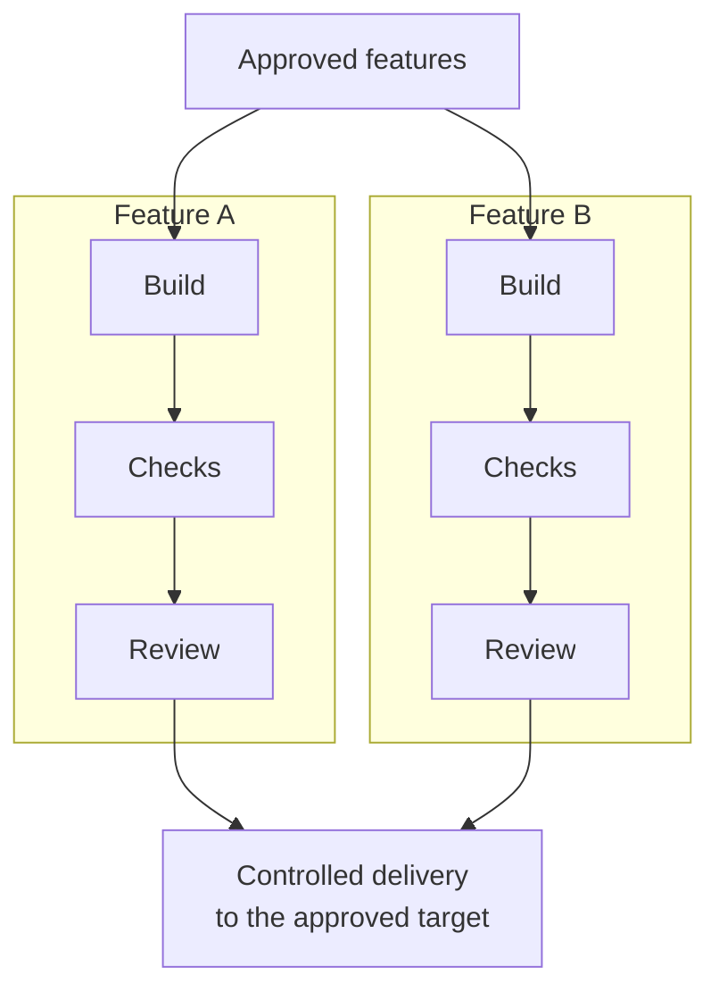

# OpenFactory

Turn approved feature requests into code changes that are built, checked,
independently reviewed, and delivered to a target you authorize.

OpenFactory coordinates AI coding agents across trusted repositories. Work can
move in parallel, while you control what runs and inspect the evidence behind it.
It runs locally with Docker Compose and makes no model calls while idle.

Powered by **[omp.sh](https://omp.sh/)**, the coding-agent harness behind
OpenFactory's coding workers.

## Parallel work, controlled delivery

Independent features get separate workspaces for building, checks, and review.
Integration into the same repository and target branch happens one at a time.



The defaults allow one active feature per project, up to two in total.
Raise the configured lane limits to run more features in parallel.
Delivery follows the approved target; not every feature is merged or released.
When integration is authorized, target-branch changes can require fresh checks
and review. See [workflows](docs/workflows.md) for dependencies and delivery targets.

## What you can do

- **Implement a feature:** define acceptance cases, approve the exact revision,
  then follow its checks, independent review, and delivery evidence.
- **Break down a larger goal:** generate a proposed plan, then choose which
  feature revisions to approve. A generated plan does not authorize execution.
- **Explore an uncertain problem:** use a Discovery Program for research and
  separately approved experiments. Proposed implementation work stays unapproved.
- **Capture an idea from your phone:** use opt-in private Intake to turn text
  into a draft, review it, and explicitly approve the work you want.

## Start with an empty stack

You need Docker with Compose **2.24.4+**, internet access, and your own model access.
For a fresh installation:

```sh
git clone https://github.com/benpoliquin/openfactory.git
cd openfactory
./start.sh
```

This builds and starts the stack, creating `.env` and `config/openfactory.yaml`
only if missing. **It enrolls no repositories and approves no work.**
It is not yet ready to implement features.

1. Open the read-only [dashboard](http://127.0.0.1:38887) or
   [OpenFactory board in BB](http://127.0.0.1:38886/plugins/openfactory/board).
   BB is the bundled agent-session web app.
2. Follow [getting started](docs/getting-started.md) to authenticate your model
   provider, select actual available model IDs in `.env`, and enroll a trusted
   repository with authentication and real checks in `config/openfactory.yaml`.
3. Follow [workflows](docs/workflows.md) to submit and approve your first feature.

Already have an installation? Review [operations](docs/operations.md) before
starting; existing environment settings can select a different stack or state.

## Use it from your phone

[OpenFactory Intake](docs/phone-intake.md) is optional and **disabled by default**.
Setup requires a private HTTPS frontdoor and device/passkey enrollment; the local
start command does not publish a phone-ready service.

Use your phone keyboard's dictation to enter **text**—there is no audio upload.
Saving a draft does not call a model. Generation is explicit, and generated work
still needs approval. The ordinary dashboard and BB board remain read-only;
the separately enabled Intake panel provides authorized actions.

## Before approving work

- Use **trusted repositories**. Workspaces and check isolation are not a sandbox
  for hostile code.
- Configure and fund your own models. A model name or successful login does not
  guarantee subscription coverage; call limits are not a hard spending cap.
- Review exact revisions and evidence. Approval is scoped, not blanket permission
  for downstream work or production deployment.
- Keep access private. Services bind to host loopback by default; this is not an
  unattended production setup. Read the [security boundaries](docs/security.md).

## Guides

| I want to… | Read |
| --- | --- |
| Connect models and enroll a repository | [Getting started](docs/getting-started.md) |
| Run features, plans, and Discovery Programs | [Workflows](docs/workflows.md) |
| Set up private phone access and passkeys | [Phone Intake](docs/phone-intake.md) |
| Configure, monitor, back up, or stop the stack | [Operations](docs/operations.md) |
| Understand trust, approvals, and isolation limits | [Security](docs/security.md) |
| Understand the internals (advanced) | [Architecture](docs/architecture.md) |
| Understand what has and has not been tested (advanced) | [Verification](docs/verification.md) |

Open source under the [MIT License](LICENSE).
