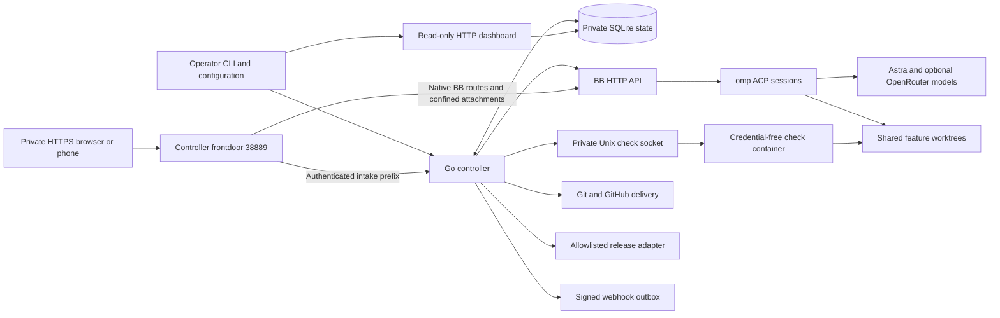
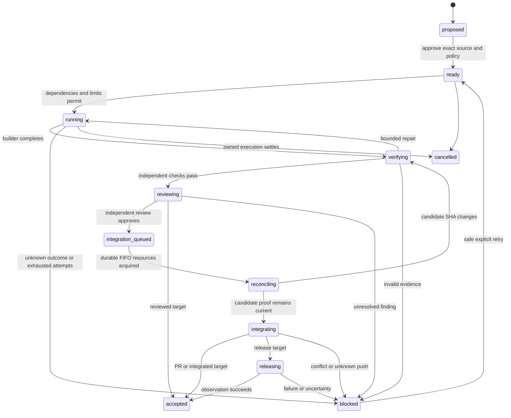
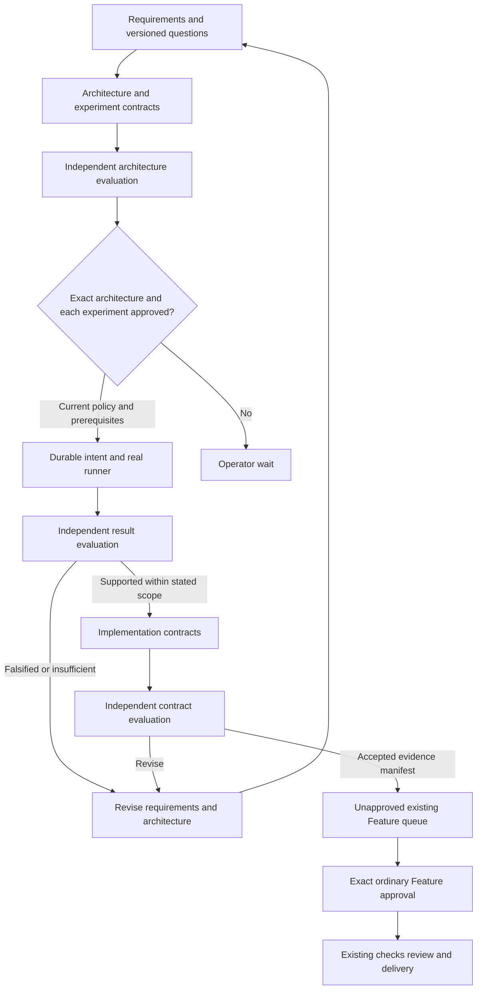

# Architecture

For contributors and operators who need the state, authority and integration contracts. OpenFactory is a small **Go + SQLite** controller for explicitly enrolled trusted repositories: approved contracts advance through **BB → omp → configured model → checks → independent review → permitted delivery**. There is no continuously reasoning supervisor, second scheduler or idle model polling.

Use [Getting started](getting-started.md), [Workflows](workflows.md) and [Phone intake](phone-intake.md) for tasks; [Operations](operations.md) for configuration/recovery; [Security](security.md) for trust limits; [Verification](verification.md) for distinctly bounded historical evidence. Source identity is `openfactory`; namespace defaults are not existing-state migration.

## Components and deployment boundaries

The frontdoor is an opt-in handler in the same controller process, not another application. Listeners are validated/prebound before admission, supervised with the engine, and drained before SQLite closes. Compose provides three services, not a distributed scheduler:

| Service | Persistent access | Credential scope |
| --- | --- | --- |
| `openfactory` | `/state`, operator `/config`, `/workspaces`, private check socket | Enrolled Git and optional webhook/release credentials |
| `bb` | Dedicated BB/omp home, `/workspaces` | Coding-model credentials only |
| `checks` | `/workspaces`, private socket, CAS, durable experiment journal, read-only execution policy | No SQLite, Git credentials, model auth or production secrets |

BB's API network contains only controller and BB. Checks have an isolated internal network by default; a trusted dependency-download overlay adds separate egress. Broker port `38888` is not host-published. Host UI ports remain loopback-only. Containers are nonroot with read-only roots except explicit volumes/tmpfs and bounded resources/processes. There is no Docker socket, SSH-agent forwarding or wholesale host-home mount. These are trusted-code boundaries, not hostile multi-tenant isolation; [Security](security.md) explains remaining filesystem, process and credential risks.

The controller owns queueing, dependencies, attempts, retry bounds, evidence, policy, integration and notification outbox. SQLite is durable authority; CAS holds immutable input/output artifacts. BB owns actual worker sessions and its UI but never mounts controller SQLite. The native plugin's server-side bridge is read-only; authenticated Intake commands go directly to the controller, never through plugin mutation RPC or BB's native chat composer. BB Workflows/Automations do not independently schedule these jobs.

## Canonical contracts and durable authority

Feature intake reuses Markdown with YAML front matter: stable ID, project, goal, dependencies, completion target, named checks and observable acceptance scenarios. Import validates identities, fields, dependencies and cycles; identical imports are idempotent. The hashed source revision plus current normalized operator-policy hash determines approval. Editing a source file does not rewrite an approved contract.

A bounded read-only Plan inspects source and proposes dependency-ordered Features, not self-approved implementation. Existing evidence/capabilities should be reused rather than rebuilt because an old roadmap lists them as missing. Program revisions, manifests, questions, captures, exact grants, experiment intents/receipts, evaluations and proposed Features live in the same SQLite/CAS authority.

SQLite authority mutations use **immediate transactions**, reserving the writer before reading approval/admission/delivery ownership. Connections receive WAL, foreign keys and a bounded busy timeout. Dashboard reads use deferred consistent snapshots rather than reserving a writer. There is no blanket retry of authority operations or external effects to hide contention. Intake command/domain mutation, audit, evidence and permanent receipt commit together through private transaction helpers; nested public Store calls are not a transaction convention and can deadlock the single-connection ledger.

Content and authority are deliberately separate:

- Source bytes and source SHA are preserved separately from normalized canonical payload/domain revision. Existing Feature hashes remain unchanged when the internal intake association is empty.
- Approval binds current exact revision, content, policy and evidence, with expiry/invalidation rechecked at admission and advancement.
- A model assertion is not a check, experiment, integration or release receipt. Producer/current-stage labels identify provenance, not grants.
- Product `DependsOn` requires ordinary **integrated** code receipts. It rejects internal discovery/intake dependencies; an open PR or reviewed-only result is not integrated code.
- Intake/Discovery associations are server-only. External imports cannot forge internal work or its authority. Product boards hide these rows while shared capacity accounts for them.

## Execution state and recovery

These are logical stages; attempts distinguish submission, execution, checks, review, integration, release and uncertainty. An accepted receipt names its achieved target, not blanket delivery authority.

The engine claims work transactionally, reserves calls **before dispatch**, and persists attempt/thread/cursor identities. Restart reconciles existing attempts before new admissions. A lost HTTP acknowledgement, idle thread, nested subagent completion, old output, interrupted root turn or malformed result is not success. An unknown spawn/push/deploy outcome retains active capacity and ownership; a timeout cannot steal it and cancellation is not proof a remote process stopped.

Pinned BB has no ordinary empty-thread creation primitive or exposed spawn/send idempotency key. The controller persists an exact attempt/stage/generation dispatch key, includes it in prompt/title, and records returned thread identity. Recovery matches durable input events, **not mutable titles**. Multiple matches or uncertain absence cannot justify resending. Environment identity may be absent during provisioning; even a durable thread still requires reconciliation. Polling uses durable cursor events and root-turn identity.

The omp launcher explicitly sets unattended approval mode, disables title-model calls, bounds runtime and limits built-in tools. These are operating constraints, not adversarial containment; shell-capable trusted workers can execute other programs. Sessions remain visible in BB. Independent review runs in a fresh role/session over the candidate and deterministic check evidence, not author self-approval.

### Model use and runtime bounds

When `fast_model` is set, every ordinary non-Plan Feature attempt first runs a read-only scout on that model. Scouting reserves its own daily dispatch and blocks if it modifies the workspace; leaving the fast model empty skips this stage and goes directly to the builder. This is an installation-wide choice, not a per-feature optimization. Prompts carry the Feature and acceptance cases, compact prior findings and actual failure output rather than entire session histories. Deterministic checks run before another review dispatch.

The controller bounds attempt duration, prompt size and retries. Defaults are three attempts, 1,800 seconds per attempt and a 24,000-byte prompt bound. CLI Plan goal files are bounded to half that prompt limit. Larger declared Discovery/Intake inputs use the scoped byte-paged tools rather than being silently truncated to a prompt-sized excerpt. See [operations](operations.md#review-the-namespace-before-starting) for the configuration bounds; dispatch limits are not provider-token or spending caps.

## Scheduler and delivery invariants

One scheduler covers ordinary Features, Program steps and Intake drafts. Global `max_concurrent` defaults to **2** and bounds all active attempts, including uncertain owners. Per-project `max_concurrent` defaults to **1**, valid **1..32**. `max_calls_per_day` defaults to **30**. Priority/dependency admission is transactional; reservations use persisted generation-qualified dispatch identity, so restarted polling cannot charge twice for one dispatch. Model sessions/dispatches are not provider-turn, token, dollar or credit ceilings.

Independent builds, checks and reviews may overlap in separate attempt workspaces. Reviewed nonlocal work enters a **durable FIFO delivery lane**. All-or-none acquisition claims canonical repository/target-branch resources; staging/production additionally claim repository/environment resources. Differently named projects cannot bypass a shared repository lane. GitHub HTTPS/SSH/scp/case aliases normalize together, local path/file URLs resolve symlinks, and custom remote host/default-port/path normalization is consistent. Configured GitHub API owner/repository must match Git transport. These are local ledger locks, not cross-controller/external Git-host locks.

A durable token fences protected operations and stays held through reconciliation, fresh candidate checks/review, PR/push, deployment, observation and rollback. Only terminal settlement with the matching attempt/token releases it. Busy delivery does not serialize unrelated builds or repositories. Startup backfills canonical ownership for legacy active/uncertain deliveries; unresolved conflicting owners block daemon admission while read/resolve CLI remains available. Reviewed-only targets create a local receipt without entering delivery.

### Immutable candidates and target movement

Each project enrolls repository, branch, trust/auth, checks, protected paths and optional releases. Controller-private Git holds network repos, indexes, candidate objects and enrollment/workspace receipts; privileged Git does not read candidate-controlled config. Source capture copies through a root-confined filesystem handle into private temporary storage so Git cannot reopen an agent-swappable path. Shared writes use volume-root confinement. Candidate checkouts fetch reachable history, not every rejected object.

The controller captures source as a single commit based on the approved base, then exports a fresh clean checkout for checks/review. Ignored builder artifacts cannot satisfy acceptance. Protected paths are checked before executing candidate checks and again before integration; review is read-only by contract and fingerprint-checked.

Before delivery, immutable source-base/source-candidate SHAs and reconciliation operation/generation are persisted. Git **2.38+** `merge-tree --write-tree` applies that **original delta** to fetched current target in a private workspace. Original source base and applicable dependency receipts must remain ancestors. Conflicts or rewritten history block without agent conflict resolution or remote writes.

A changed candidate gets a new generation and fresh checks/independent review, rechecked protected paths and release allowlists, still under existing call bounds. Reconciliation is idempotent by operation/generation and never rewrites a running agent's workspace. Failed refreshed proof blocks rather than silently repairing/replacing the approved delta.

Final integration requires a direct parent equal to the expected target SHA and uses an explicit `--force-with-lease=refs/heads/<branch>:<expected>` push: despite the Git option's name, this is an exact compare-and-swap **fast-forward**, not unconditional force/history overwrite. Known target movement returns to reconciliation; ambiguous outcomes retain ownership. PR publication uses a create-only feature ref and verifies head/base without overwriting unexpected refs.

## Discovery Programs

A Program is a versioned research objective, not delivered code. Lifetime call, iteration, step, experiment, search, source and captured-byte budgets survive answers/reimports. Questions are durable version-bound waits with no polling model calls; answers create new unapproved revisions. Independent evaluation has a separate role/session and controller-stamped input identity.

Public research uses explicitly disclosed topics/URLs through a fixed keyless Parallel MCP broker, not provider fallback. Captures retain response-body/extracted-text hashes, quote-occurrence provenance and GitHub commit provenance where applicable. Public input is untrusted data; quote occurrence does not establish truth or vendor internals.

Discovery starts without a product clone and exposes **six custom discovery tools**, no native bash/eval/task/web tools. Complete immutable context/source/CAS is materialized under `inputs/` for bounded paging rather than silently truncating at the **24 KB** default prompt bound. Role-specific write rules prevent evaluators authoring/retracting others' artifacts. Declared regular-file private bundles can be shape-validated/stored with zero model work and consent false; strict research/execution approval independently requires applicable private/provider/public-search disclosure. Browser `file://` paths are never public sources.

Experiments run only enrolled argv profiles with bounded arguments, not arbitrary model shell. Exact `ExecutionPolicySHA` binds profiles/limits at controller/runner launch; stale checker policy fails closed. Checks gets CAS, a durable journal and read-only policy, not SQLite/provider/Git auth. The Unix runner is a trusted same-UID service. Intent/status/receipt/cancellation tombstones are durable/idempotent; uncertain launches cannot be blindly replayed. Never-started tombstones settle identity without fabricating observations.

Frozen `BundleFiles` cannot also be observation outputs. Conclusions require complete typed observations/predicates: nonzero exit alone is not falsification, while a complete failing predicate with exit zero can be. Missing prerequisites, timeout, infrastructure fault and truncated output remain distinct from hypothesis outcomes. Receipts distinguish execution, observation and hypothesis; binary SHA is observed, OCI identity operator-declared, and service limits are not measured per-run consumption.

A separate `ProgramEvidenceGate` protects proposed Features. Invalidation blocks remaining authority and emits impact findings for already accepted work without erasing historical receipts. No automatic provider/account/hardware authority follows. The read-only Programs API/list/detail exposes bounded revision/history, questions, architecture, experiments, evidence, Features and events; provenance labels do not approve output.

### Failed-worker and experiment recovery

Program resume selects at most one current settled failed worker. Review binds immutable safe input, internal Feature revision/state/attempt count and latest settled-attempt fingerprints; commit rederives the selection. Active/uncertain ownership, superseded input, cancelled Program or exhausted lifetime/attempt caps cannot be cleared by retry. Existing retry/admission machinery creates the next attempt without resetting counters/history.

Experiment recovery reviews the exact frozen `ExperimentContract` preimage while ProgramSpec remains source/manifest identity. Architecture/contract grants, bundle and execution-policy bindings must still match. Recorded launches need terminal **non-conclusive failure** evidence; supported/falsified receipts are not failures to rerun. `prior_launch_absent` requires a settled attempt and no recorded dispatch, thread, environment, call, intent or receipt—not absence of a receipt after an intent. A new attempt derives a new canonical run identity. `max_experiments` counts logical steps; physical retries need fresh exact grants and obey Feature attempt/per-run bounds. Model retries still reserve daily/Program-lifetime dispatches.

## Intake: canonical content and exact human grants

The native panel at `/plugins/openfactory/intake/` accepts OS-keyboard text, not audio. `request.create`/`turn.append` save exact text/client identity without model work or disclosure consent. Reload/poll/wait also make no model calls. Send composes Save then a separate explicit `intake.draft`; `/openfactory-intake/v1/disclosures` prepares current content, exact model/provider selectors, policy and selected bundle hashes before consent. There is no arbitrary browser model selector, silent trimming or fallback.

Requests, append-only turns, questions, immutable drafts, worker links and monotonic progress are in SQLite/CAS. Writes require expected `ContentVersion`; progress alone does not invalidate unchanged review. A request's project is immutable; switching projects or amending submitted work makes a linked request. Output is a strict union: one to three consequential questions, Feature/Plan/Program draft, or blocked prerequisite—not an automatic repair loop or invented result.

Intake dispatches use the existing internal Feature → Attempt → reservation → BB lifecycle. One active step and a frozen default lifetime cap of **12 draft dispatches** survive edit/retry/reconnect/restart. Creating a step leaves it queued; rejected Claim records the actual admission wait without attempt/call charge. Successful Claim atomically binds attempt, publishes drafting and clears the queued wait. SetWait/Save/ReserveCall/reconciliation mirror the owned attempt's actual wait and clearing; there is no optimistic parallel admission algorithm.

The pinned intake profile starts in an empty scoped workspace without a product checkout. Only `intake_read` pages immutable manifest-bound context/CAS using UTF-8 byte bounds; no native shell/eval/task/web/read/write, ambient extensions, skills or research tools. One active/superseded/uncertain owner must settle before replacement releases capacity.

Canonical review preserves exact source bytes/SHA separately from domain revision, reusing Feature parsing/export, read-only plan construction and Program normalization. Feature queueing grants only permitted project/check/target authority. Plan answers bind revision/attempt/output SHA and make new unapproved revisions; published children remain unapproved. Program revisions, architecture, **each** frozen experiment and final products need distinct grants. Upload/finalization/canonical replacement is not consent; `intake.approve_queue` atomically imports **plus grants execution**, rejecting missing disclosure before human proof or partial domain effects.

### Authentication and command durability

Trusted CLI enrollment creates explicitly project-scoped operators. Pairing stores only SHA-256 of a one-time 256-bit secret carried in a URL fragment, cleared before exchange. Maintained **go-webauthn/webauthn v0.18.2** verifies required UV, exact configured RP/origin and server-held ceremony state. Library counter/backup semantics apply; synced zero-counter passkeys are not universally rejected. A pending credential activates only after trusted CLI confirms the full fingerprint from its successful registration screen; mismatch revokes pairing, and login is a separate fresh ceremony.

Session cookie `openfactory_intake_session` is HttpOnly, Secure, SameSite=Strict, scoped to `/openfactory-intake/`, with live actor/credential/generation/project scope. Writes require exact Origin, JSON and synchronizer `X-OpenFactory-CSRF`. No CORS/header/service-key identity replaces these checks.

Every authority grant uses fresh UP+UV bound to a typed command: queue, Feature/Program revision, architecture, individual experiment or retry/resume. Review binds installation/actor/credential, request/content/draft versions, canonical payload/manifest, policy, subject/evidence/bundle, command/challenge and expiry. Commit accepts stored command/challenge IDs plus assertion, not replacement authority fields. Current scope, revisions, evidence, policy, credential and one-time challenge consumption are checked in the same transaction as mutation/audit/receipt. Trusted CLI records `trusted_local`, never fictional WebAuthn proof. The browser verifies supplied canonical bytes, not reconstructed Go JSON; policy SHA remains an opaque fingerprint because private global argv/host paths are not exposed.

`POST /openfactory-intake/v1/commands` accepts a strict action-specific union with stable UUID and expected content version, not supplied actor/approval/shell/provider/policy. Authentication precedes receipt lookup. Permanent actor+command tombstones return the same result for identical input and reject changed content under that ID. A genuinely new stale command fails rather than replaying against new subjects. Browser recovery journals only scoped non-sensitive command/fence/disclosure metadata; lost responses reconcile/retry identical IDs. Generation/installation mismatch stays unresolved. Submitted means handoff committed, not delivered; revocation prevents future commands but does not cancel already approved work. Mandatory restored-state auth rotation and ownership reconciliation are described once in [Phone recovery](phone-intake.md#revoke-access-or-restore-authentication).

### Same-origin private frontdoor

The optional existing listener defaults to `127.0.0.1:38889`; disabled Intake opens none. Bootstrap exposes enabled/origin/path/RP name, not credential existence/private config. One private HTTPS origin forwards **all paths intact**: the frontdoor strips `/openfactory-intake` internally into `/v1`, bare `/v1/*` is not public, and remaining paths proxy native BB with WebSocket/SSE. Optional `bb_host_authority` alters only Host, never URL/DNS/TLS SNI/certificate identity. Exact lowercase origin/RP rules reject credentials, path/trailing slash, explicit default ports and remote HTTP; exact `http://localhost:PORT` is isolated development only.

The proxy strips operator cookie/CSRF before BB while retaining native BB cookies/actual Origin and never trusts forwarded actor identity. Worker attachment route `/api/v1/projects/{oneID}/attachments/content` gets enforcing CSP `sandbox allow-scripts` **without `allow-same-origin`**, plus `nosniff`, for all types/statuses including 304/errors. Existing CSP remains enforced; escaped IDs, queries, normalized paths and BB base paths do not bypass confinement. Other BB responses are not blanket-rewritten. BB receives no auth/database/token mount or bridge key. No direct route may bypass the frontdoor. [Phone intake](phone-intake.md) owns the complete private HTTPS deployment and enrollment procedure; [Operations](operations.md#intake-policy-reference) owns exact configurable defaults.

## Release, visibility and integration contracts

Release profiles name qualified/expiring target authority, allowed risks/paths, deploy/observe/rollback argv, observation duration/minimum samples. They bind Feature, policy, exact integrated SHA and evidence. Side-effect-free preflight checks path/profile/command bounds and remaining observation/rollback budget **before integration**. No profile means no release; expiry, protected changes, failed observations and uncertainty block. Executables are operator-owned under read-only `release_dir`, never candidate scripts, running in a controller-private clean snapshot. Rollback must be enrolled and does not promise reversible databases.

The read-only dashboard/CLI/BB threads/signed outbox expose actual progress, waits, generations and delivery resources, not forecasts or invented completion. The plugin uses the same bounded `/api/status` snapshot and has no mutation RPC. Its bridge uses `node:http`/`node:https`: pinned BB's Node 24 `fetch` ignored explicit Host overrides. Transport retains configured URL/DNS/TLS identity while sending loopback Host authority with the configured port; no redirects, proxies, cookies or authentication are supplied, with streaming/abort bounds preserved. This does not weaken dashboard Host checks. Notifications are durable at-least-once signed identifier-only events, never authority. Tuning/routes/webhook verification are in [Operations](operations.md).

## Implementation map and pinned sources

| Source | Responsibility |
| --- | --- |
| [engine](../internal/engine/engine.go), [supervision](../internal/engine/supervision.go) | Existing scheduler, worker lifecycle and restart reconciliation |
| [model](../internal/model/model.go), [Program hashing](../internal/model/program_hash.go), [config](../internal/config/config.go) | Shared contracts, canonical identity, normalized policy |
| [Store](../internal/store/store.go), [authority](../internal/store/authority.go), [execution](../internal/store/execution.go), [reconciliation](../internal/store/reconciliation.go) | Durable transactional authority, ownership and receipts |
| [BB client](../internal/bb/client.go) | Public pinned HTTP/wire contracts |
| [Git reconciliation](../internal/gitrepo/reconcile.go), [release](../internal/gitrepo/release.go) | Candidate generations, exact delivery and release |
| [executor](../internal/executor/executor.go), [experiments](../internal/executor/experiments.go), [research](../internal/research/service.go) | Private check/experiment service and public capture broker |
| [intake](../internal/intake/intake.go), [canonical bytes](../internal/intake/canonical.go), [engine intake](../internal/engine/intake.go) | Typed protocol, shared canonical formats and scheduler integration |
| [frontdoor](../internal/frontdoor/frontdoor.go), [command API](../internal/commandapi/server.go), [WebAuthn](../internal/operatorauth/webauthn.go) | Browser-origin confinement, authenticated commands and maintained verification |
| [dashboard](../internal/dashboard/dashboard.go), [views](../internal/dashboard/views.go), [plugin intake](../plugins/openfactory/intake.tsx), [CLI](../cmd/openfactory) | Read-only visibility, native UI and trusted terminal commands |

Pinned integrations: **BB 0.47.1**, **omp 18.10.3**, **@get-bb/plugin-sdk 0.6.79**, **go-webauthn/webauthn v0.18.2**. Astra is a configured selector for planning/build/review, with optional approved OpenRouter scouting—not guaranteed subscription access. Compatibility must be reverified on upgrades.

Inspected upstream contracts and design references:

- [BB package/SDK/launcher at inspected commit](https://github.com/get-bb/bb/tree/5e1acd765039e874643f34c4d35409e58484e408/packages/bb-app) and [thread SDK contracts](https://github.com/get-bb/bb/blob/5e1acd765039e874643f34c4d35409e58484e408/packages/sdk/src/areas/threads.ts)
- [omp ACP/RPC](https://github.com/can1357/oh-my-pi/blob/v18.10.3/docs/rpc.md) and [approval policy](https://github.com/can1357/oh-my-pi/blob/v18.10.3/docs/approval-mode.md)
- [OpenRouter provider selection](https://openrouter.ai/docs/guides/routing/provider-selection) and [SQLite consistent backup](https://www.sqlite.org/backup.html)
- [Anthropic: long-running harnesses](https://www.anthropic.com/engineering/effective-harnesses-for-long-running-agents), [OpenAI: harness engineering](https://openai.com/index/harness-engineering/), [Symphony specification](https://github.com/openai/symphony/blob/main/SPEC.md) and [StrongDM factory principles](https://factory.strongdm.ai/principles)

These references informed implementation; they do not supply production qualification. No Muse/WhatsApp integration, plugin marketplace or distributed scheduler is implied. [Back to README](../README.md).
